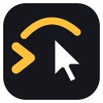
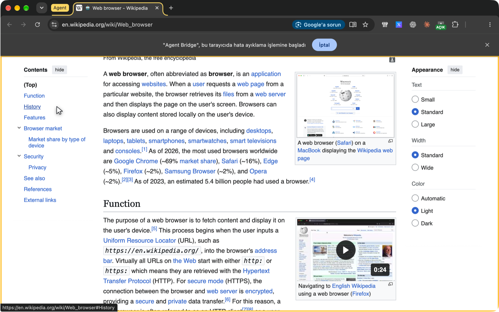
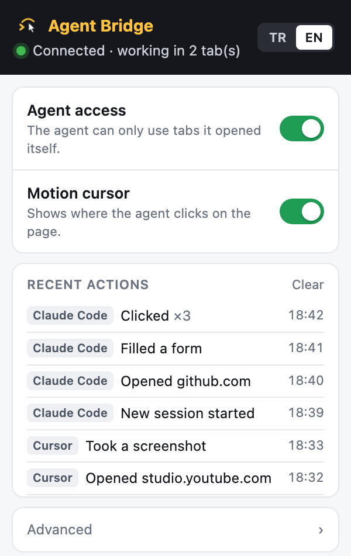

<p align="center"></p>

<h1 align="center">Agent Bridge</h1>

**English** · [Türkçe](README.tr.md)

Let terminal agents (Claude Code, Cursor, Codex… anything that speaks MCP) work in **your own Chrome**: read pages, click, type, fill forms, upload files, take screenshots. They do it **with your logged-in sessions**, so YouTube Studio, Search Console, TikTok, Business Suite and the rest stay signed in.

That's the difference from Playwright / DevTools MCP, which start an empty browser with no sessions. Agent Bridge connects to the browser you already use.



*Agent tabs are easy to spot: they sit in a yellow **Agent** tab group, the page gets a gold frame, and the motion cursor shows where the agent points and clicks.*

## How it works

```
agent (MCP client)  ⇄ stdio ⇄  agent-bridge  ⇄ WebSocket (127.0.0.1) ⇄  Chrome extension  ⇄  pages
                                              (token-protected)          (chrome.debugger)
```

- The **extension** uses the `chrome.debugger` API, so there is no remote debugging port (9222) to open.
- The **bridge** listens on `127.0.0.1` only. The extension sends a token when it connects, and a wrong token is rejected.
- Nothing leaves your machine, screenshots included.

## Installation

Two parts, nothing to clone: the **MCP server** comes from npm, the **Chrome extension** from the latest GitHub release.

**Requirements:** Node.js 18+, Chrome 116+ (or another Chromium browser: Edge, Brave, Arc).

### 1. Add the MCP server to your agent

<details open>
<summary><b>Claude Code</b></summary>

```bash
claude mcp add --scope user agent-bridge -- npx -y chrome-agent-bridge
```
</details>

<details>
<summary><b>Claude Desktop</b>: <code>~/Library/Application Support/Claude/claude_desktop_config.json</code></summary>

```json
{
  "mcpServers": {
    "agent-bridge": {
      "command": "npx",
      "args": ["-y", "chrome-agent-bridge"]
    }
  }
}
```
</details>

<details>
<summary><b>Cursor</b>: <code>~/.cursor/mcp.json</code></summary>

```json
{
  "mcpServers": {
    "agent-bridge": {
      "command": "npx",
      "args": ["-y", "chrome-agent-bridge"]
    }
  }
}
```
</details>

<details>
<summary><b>Codex CLI</b>: <code>~/.codex/config.toml</code></summary>

```toml
[mcp_servers.agent-bridge]
command = "npx"
args = ["-y", "chrome-agent-bridge"]
```
</details>

<details>
<summary><b>VS Code (Copilot)</b>: <code>.vscode/mcp.json</code> or the user <code>mcp.json</code></summary>

```json
{
  "servers": {
    "agent-bridge": {
      "type": "stdio",
      "command": "npx",
      "args": ["-y", "chrome-agent-bridge"]
    }
  }
}
```
</details>

Any other MCP client works the same way: a **stdio** server with command `npx` and arguments `-y chrome-agent-bridge`. Restart the agent after adding it.

> GUI apps (Claude Desktop, Cursor…) don't see your shell `PATH`, so `npx` (or the `node` it needs) may not be found. Then use the full path from `which npx` and pass your `PATH` along:
>
> ```json
> "agent-bridge": {
>   "command": "/opt/homebrew/bin/npx",
>   "args": ["-y", "chrome-agent-bridge"],
>   "env": { "PATH": "/opt/homebrew/bin:/usr/bin:/bin" }
> }
> ```

### 2. Download the extension and load it into Chrome

**Download:** [agent-bridge-extension.zip](https://github.com/falconsw/agent-bridge/releases/latest/download/agent-bridge-extension.zip) (always the latest release; all versions are on the [Releases](https://github.com/falconsw/agent-bridge/releases) page)

1. Unzip it into a folder you will keep, e.g. `~/agent-bridge-extension`. Chrome loads the extension straight from this folder, so don't delete or move it later.
2. Open `chrome://extensions`.
3. Turn on **Developer mode** (top right).
4. Click **Load unpacked** and select the unzipped folder (the one that contains `manifest.json`).
5. Click the puzzle icon in the toolbar and **pin** Agent Bridge.

> Why not a `.crx` file? Chrome on Windows and macOS refuses to run `.crx` extensions that don't come from the Chrome Web Store. Until the store release, "Load unpacked" is the way.

### 3. Pair (one switch)

Open the Agent Bridge popup and turn on **Agent access**. The first connection pairs automatically (trust on first use), and the pairing is saved to `~/.agent-bridge/token.json`. The status turns green ("Connected").

Then just ask your agent something like *"open search console and tell me which pages lost clicks this week"*.

To pair again (for example after reinstalling the extension), run `npx -y chrome-agent-bridge --fresh` once and stop it with Ctrl+C.

### Updating

- **MCP server:** `npx` caches the package; to get the newest version run `npx -y chrome-agent-bridge@latest --help` once, then restart your agent.
- **Extension:** download the zip again, replace the folder's contents, and click **Reload** on Agent Bridge in `chrome://extensions`.

### From source (development)

```bash
git clone https://github.com/falconsw/agent-bridge.git
cd agent-bridge && npm install
```

Load the `extension/` folder with "Load unpacked", and use `node /path/to/agent-bridge/bin/agent-bridge.mjs` as the MCP command.

## The popup



- **Agent access:** the master switch. When it's off, the agent can't touch the browser.
- **Motion cursor:** shows a pointer and click ripple on the page wherever the agent clicks or types.
- **Recent actions:** a plain-language log ("Opened instagram.com", "Clicked ×3"), with a badge for the app it came from (Claude Code, Cursor, Codex…).
- **Advanced:** port, pairing token, and blocked URL patterns.

<br clear="right">

## Tools

| Tool | What it does |
| --- | --- |
| `navigate` | Goes to a URL (or `back`/`forward`/`reload`), **waits for the load and returns the page snapshot** |
| `read` | Page snapshot: `role "label" rN [state]` lines, tables as `row "cell | cell"`. `mode: "all"` adds the full text; narrow it with `ref`/`selector`/`viewport` |
| `find` | Searches labels and text, returns matching lines with refs and link targets (much cheaper than `read`) |
| `click` / `hover` | **Real mouse events** on `rN`, a CSS selector or a label; waits for the page to settle and returns **only what changed** |
| `type` / `fill` | Real keyboard input; `fill` completes a whole form in one call: text, `<select>`, checkbox/radio (`true`/`false`) |
| `select` | Picks a native `<select>` option |
| `key` | Keys and shortcuts: `Enter`, `Escape`, `Tab Tab Enter`, `cmd+a` |
| `scroll` | Scrolls and returns what is now visible |
| `upload` | Gives a local file to an `<input type=file>` (photos/videos for posts) |
| `wait` | Waits until text/a selector appears (or disappears with `gone`) |
| `console` / `network` | The tab's console messages and network requests |
| `screenshot` | JPEG of the visible area (up to 1280 px); expensive, only for visual questions. Saved under `~/.agent-bridge/shots` |
| `eval` | Runs JavaScript in the page (last resort) |
| `tabs` | The agent's tabs; `switchTo`, `close` |
| `done` | Closes the agent's tabs when the whole task is finished |

**Token-efficient:** `navigate` already returns the snapshot, actions report only new elements (or the new page), repeated lines are merged, and hidden/`aria-hidden` elements are skipped. Dialogs (alert/confirm) are accepted and reported, and new tabs opened by an agent tab are handed to the agent. Shadow DOM and same-origin iframes are read too.

**Several agents at once:** the first bridge process takes the port, and later sessions (Claude Code, Cursor, Codex…) join it as drivers. When the first one exits, another takes over the port.

## Benchmark

Same tasks, same model (`sonnet`), each in a fresh headless Claude Code session that may use only one browser tool. Medians of 3 runs; all 18 runs answered correctly.

| 3 tasks in total | Agent Bridge | Claude in Chrome |
| --- | ---: | ---: |
| Tokens (input + output) | **146.5k** | 343.2k |
| Browser tool calls | **6** | 22 |
| Tokens returned by browser tools | **5.1k** | 11.3k |
| Time | **39.9 s** | 78.2 s |
| Cost | **$0.124** | $0.259 |

Each operation and what it cost, e.g. filling a 7-field form:

- **Agent Bridge:** `navigate` (245 tok) → `fill` (277) → `click` (769): 3 calls
- **Claude in Chrome:** `navigate` (345) → `read_page` (363) → `form_input` ×8 (~240 each) → `javascript_tool` (280) → `computer` (270) → `get_page_text` (867) → `tabs_close_mcp` (74): 14 calls

Full results, per-task tables and tokens per operation: [bench/RESULTS.md](bench/RESULTS.md). Reproduce with `node bench/run.mjs --runs 3` and `node bench/report.mjs`.

## Security

- **Tab isolation:** the agent only works in **tabs it opened itself**. It cannot list, navigate or click your own tabs.
- **Privacy filter:** password, hidden and autofill-sensitive fields (credit cards, OTP) **never appear** in snapshots, so the model cannot see them.
- **Blocked URL patterns:** add them in popup → Advanced, comma separated (e.g. `bank.example.com/*, *.gov/*`). `navigate` refuses those addresses.
- **Idle mode:** when the agent calls `done`, or after 10 minutes without a command, all agent tabs close and the debugger detaches.
- The bridge listens on `127.0.0.1` only and pairs by token. Any local process that knows the token can drive the browser; on a single-user machine that is the boundary, as with any local dev tool.
- Because it uses `chrome.debugger`, Chrome shows a "**… started debugging this browser**" bar on agent tabs. That is intentional: it shows when it's active.
- **Prompt injection:** a malicious page's text can try to steer the agent. The popup log shows what was done; still, keep an eye on it when the agent works in important accounts.

## Development

The tests need no Chrome; they run end to end against a fake extension:

```bash
node test/fake-extension.mjs 8799 TEST-TOKEN &   # side 1
npm test                                          # side 2: two bridges + takeover test
```

Bridge options: `node bin/agent-bridge.mjs --help` (`--port`, `--token`, `--shots`, `--lang tr|en`, `--fresh`).

## Roadmap

- [ ] Chrome Web Store release
- [ ] Site allowlist (act only on listed domains)
- [ ] Confirm mode (notification + approval before side-effecting actions)
- [x] npm package (`npx -y chrome-agent-bridge`)

## License

MIT
