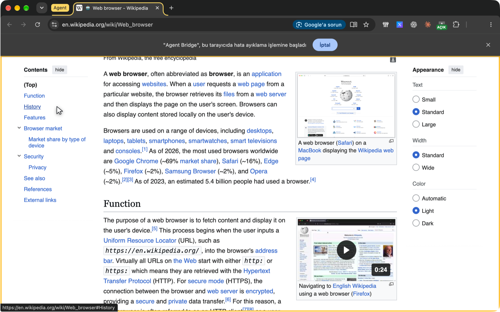
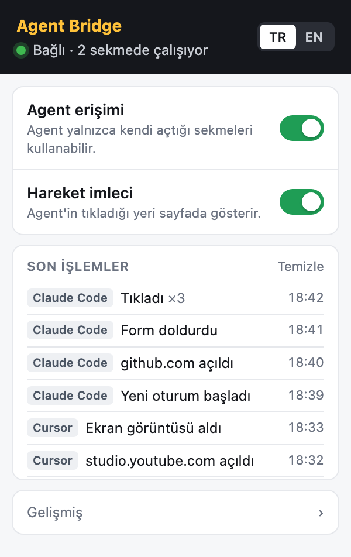

# Agent Bridge

[English](README.md) · **Türkçe**

Terminal agent'larına (Claude Code, Cursor, Codex… MCP konuşan herkes) **kendi Chrome'unuzda** işlem yaptıran köprü. Agent sayfa okur, tıklar, yazar, form doldurur, dosya yükler, ekran görüntüsü alır. Bunu **sizin oturumlarınızla** yapar: YouTube Studio, Search Console, TikTok, Business Suite… hepsi girişli kalır.

Playwright/DevTools MCP'den farkı burada: onlar boş, oturumsuz bir tarayıcı açar. Agent Bridge ise zaten kullandığınız tarayıcıya bağlanır.



*Agent sekmeleri kolayca ayırt edilir: sarı **Agent** sekme grubunda dururlar, sayfa altın bir çerçeve alır ve hareket imleci agent'ın nereyi gösterip tıkladığını gösterir.*

## Nasıl çalışır

```
agent (MCP istemcisi)  ⇄ stdio ⇄  agent-bridge  ⇄ WebSocket (127.0.0.1) ⇄  Chrome eklentisi  ⇄  sayfalar
                                                (token korumalı)           (chrome.debugger)
```

- **Eklenti** `chrome.debugger` API'sini kullanır, uzaktan hata ayıklama portu (9222) açmaya gerek yoktur.
- **Köprü** yalnız `127.0.0.1`'i dinler. Eklenti bağlanırken token gönderir, yanlış token reddedilir.
- Ekran görüntüleri dahil hiçbir veri makinenizden çıkmaz.

## Kurulum

> Eklenti henüz Chrome Web Mağazası'nda değil. Şimdilik bu depodan "paketlenmemiş" olarak yüklenir.

**Gereksinimler:** Node.js 18+, Chrome 116+ (ya da başka bir Chromium tarayıcı: Edge, Brave, Arc).

### 1. Kodu indir

```bash
git clone https://github.com/falconsw/agent-bridge.git
cd agent-bridge
npm install
```

### 2. Eklentiyi Chrome'a yükle (bir kez)

1. `chrome://extensions` adresini aç.
2. Sağ üstten **Geliştirici modu**'nu aç.
3. **Paketlenmemiş öğe yükle**'ye tıkla ve bu depodaki `extension/` klasörünü seç.
4. Araç çubuğundaki yapboz simgesine tıkla ve Agent Bridge'i **sabitle**.

> Klasörü sonradan taşımayın ya da silmeyin: Chrome eklentiyi doğrudan oradan yükler.

### 3. Agent'ına MCP sunucusu olarak ekle

**Mutlak yol** kullanın. Masaüstü uygulamaları (Claude Desktop, Cursor…) kabuğunuzun `PATH`'ini görmez, bu yüzden `node`'un da tam yolunu verin: `which node` yazdırır (ör. `/opt/homebrew/bin/node`). Aşağıdaki `/yol/agent-bridge` yerine depoyu klonladığınız yeri yazın (içindeyken `pwd`).

<details open>
<summary><b>Claude Code</b></summary>

```bash
claude mcp add --scope user agent-bridge -- node /yol/agent-bridge/bin/agent-bridge.mjs
```
</details>

<details>
<summary><b>Claude Desktop</b>: <code>~/Library/Application Support/Claude/claude_desktop_config.json</code></summary>

```json
{
  "mcpServers": {
    "agent-bridge": {
      "command": "/opt/homebrew/bin/node",
      "args": ["/yol/agent-bridge/bin/agent-bridge.mjs"]
    }
  }
}
```
</details>

<details>
<summary><b>Cursor</b>: <code>~/.cursor/mcp.json</code></summary>

```json
{
  "mcpServers": {
    "agent-bridge": {
      "command": "/opt/homebrew/bin/node",
      "args": ["/yol/agent-bridge/bin/agent-bridge.mjs"]
    }
  }
}
```
</details>

<details>
<summary><b>Codex CLI</b>: <code>~/.codex/config.toml</code></summary>

```toml
[mcp_servers.agent-bridge]
command = "/opt/homebrew/bin/node"
args = ["/yol/agent-bridge/bin/agent-bridge.mjs"]
```
</details>

<details>
<summary><b>VS Code (Copilot)</b>: <code>.vscode/mcp.json</code> ya da kullanıcı <code>mcp.json</code> dosyası</summary>

```json
{
  "servers": {
    "agent-bridge": {
      "type": "stdio",
      "command": "/opt/homebrew/bin/node",
      "args": ["/yol/agent-bridge/bin/agent-bridge.mjs"]
    }
  }
}
```
</details>

Diğer MCP istemcileri de aynı şekilde çalışır: komutu `node`, argümanı `/yol/agent-bridge/bin/agent-bridge.mjs` olan bir **stdio** sunucusu. Ekledikten sonra agent'ı yeniden başlatın.

### 4. Eşleştir (tek anahtar)

Agent Bridge popup'ını açın ve **Agent erişimi** anahtarını açın. İlk bağlantı otomatik eşleşir (ilk bağlanana güven, TOFU) ve eşleşme `~/.agent-bridge/token.json`'a kaydedilir. Durum yeşile döner ("Bağlı").

Sonra agent'ınızdan bir şey isteyin, ör. *"search console'u aç, bu hafta tıklaması düşen sayfaları söyle"*.

Yeniden eşleştirmek gerekirse (ör. eklentiyi yeniden kurduktan sonra) köprüyü bir kez `--fresh` ile başlatın.

### Güncelleme

```bash
git pull && npm install
```

Sonra `chrome://extensions`'ta Agent Bridge'in **Yeniden yükle** düğmesine basın ve agent'ı yeniden başlatın.

## Popup



- **Agent erişimi:** ana anahtar. Kapalıyken agent tarayıcıya dokunamaz.
- **Hareket imleci:** agent'ın tıkladığı ya da yazdığı yerde sayfada imleç ve tıklama efekti gösterir.
- **Son işlemler:** sade dilde günlük ("instagram.com açıldı", "Tıkladı ×3"). Her satırda işlemin geldiği uygulamanın rozeti bulunur (Claude Code, Cursor, Codex…).
- **Gelişmiş:** port, eşleşme token'ı ve engellenen adres kalıpları.

<br clear="right">

## Araçlar

| Araç | İş |
| --- | --- |
| `navigate` | Adrese gider (ya da `back`/`forward`/`reload`), **yüklenmeyi bekler ve sayfa görüntüsünü döndürür** |
| `read` | Sayfa görüntüsü: `rol "etiket" rN [durum]` satırları, tablolar `row "hücre | hücre"` olarak. `mode: "all"` tüm metni de ekler; `ref`/`selector`/`viewport` ile daraltılır |
| `find` | Etiket ve metinde arar, eşleşen satırları ref ve link adresiyle döndürür (`read`'den çok daha ucuz) |
| `click` / `hover` | `rN`, CSS seçici ya da etiketle **gerçek fare olayı**; sayfa durulana kadar bekler, **yalnız değişeni** döndürür |
| `type` / `fill` | Gerçek klavye girdisi; `fill` bütün formu tek çağrıda doldurur: metin, `<select>`, onay kutusu/radyo (`true`/`false`) |
| `select` | Yerel `<select>` seçeneği seçer |
| `key` | Tuş ve kısayollar: `Enter`, `Escape`, `Tab Tab Enter`, `cmd+a` |
| `scroll` | Kaydırır, ekranda görünenleri döndürür |
| `upload` | `<input type=file>` alanına yerel dosya verir (post için fotoğraf/video) |
| `wait` | Metin/seçici görünene (ya da `gone` ile kaybolana) kadar bekler |
| `console` / `network` | Sekmenin konsol mesajları ve ağ istekleri |
| `screenshot` | Görünen alanın JPEG'i (1280 px'e kadar); pahalıdır, yalnız görsel sorular için. `~/.agent-bridge/shots` altına kaydedilir |
| `eval` | Sayfada JavaScript çalıştırır (son çare) |
| `tabs` | Agent sekmeleri; `switchTo`, `close` |
| `done` | İş tamamen bitince agent sekmelerini kapatır |

**Token tasarrufu:** `navigate` görüntüyü zaten döndürür, eylemler yalnız yeni çıkan öğeleri (ya da yeni sayfayı) bildirir, aynı satırlar birleşir, görünmeyen/`aria-hidden` öğeler atlanır. Açılır pencereler (alert/confirm) kabul edilip bildirilir, agent sekmesinin açtığı yeni sekmeler agent'a geçer. Shadow DOM ve aynı kökenli iframe'ler de okunur.

**Birden çok agent:** ilk köprü süreci portu alır, sonraki oturumlar (Claude Code, Cursor, Codex…) ona sürücü olarak katılır. İlk süreç kapanınca bir diğeri portu devralır.

## Güvenlik

- **Sekme yalıtımı:** agent yalnız **kendi açtığı sekmelerde** çalışır. Sizin sekmelerinizi listeleyemez, onlarda gezinemez, tıklayamaz.
- **Gizlilik filtresi:** şifre, gizli ve otomatik doldurma duyarlı alanlar (kredi kartı, OTP) sayfa görüntüsünde **hiç görünmez**, model onları göremez.
- **Engellenen adres kalıpları:** popup → Gelişmiş'e virgülle yazın (ör. `banka.example.com/*, *.gov.tr/*`). `navigate` o adresleri reddeder.
- **Bekleme modu:** agent `done` çağırınca ya da 10 dakika işlem olmayınca tüm agent sekmeleri kapanır ve debugger ayrılır.
- Köprü yalnız `127.0.0.1`'i dinler ve token'la eşleşir. Token'ı bilen her yerel süreç tarayıcıyı sürebilir; tek kullanıcılı makinede sınır budur (her yerel geliştirme aracında olduğu gibi).
- `chrome.debugger` kullandığı için agent sekmelerinde Chrome'un "**… tarayıcıda hata ayıklamaya başladı**" çubuğu görünür. Bu bilerek böyle: ne zaman devrede olduğunu gösterir.
- **Prompt injection:** kötü niyetli bir sayfanın metni agent'ı yönlendirmeye çalışabilir. Popup'taki günlük ne yapıldığını gösterir; yine de önemli hesaplarda agent çalışırken göz kulak olun.

## Geliştirme

Testler Chrome gerektirmez, sahte eklentiyle uçtan uca çalışır:

```bash
node test/fake-extension.mjs 8799 TEST-TOKEN &   # 1. uç
npm test                                          # 2. uç: iki köprü + devralma testi
```

Köprü seçenekleri: `node bin/agent-bridge.mjs --help` (`--port`, `--token`, `--shots`, `--lang tr|en`, `--fresh`).

## Yol haritası

- [ ] Chrome Web Mağazası sürümü
- [ ] Site izin listesi (yalnız listedeki alan adlarında işlem)
- [ ] Onay modu (yan etkili işlem öncesi bildirim + onay)
- [ ] npm paketi (`npx`)

## Lisans

MIT
